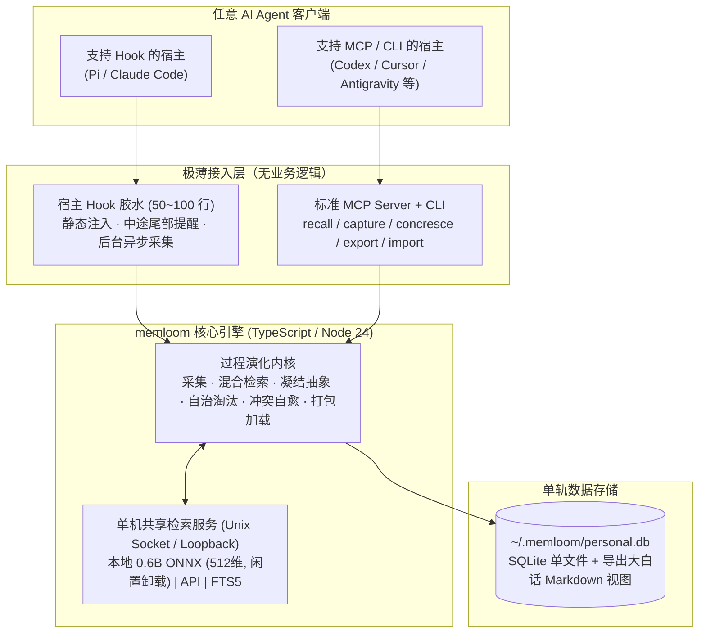

# memloom

**把 AI Agent 每次干活攒下的零散经历，织成真正管用、人也能一眼看懂的工作原则。**

`memloom`（Memory + Loom）是一套面向 **干活型 AI Agent** 的轻量个人记忆与原则演化引擎。它跟着**你这个人**走，不绑死任何一款特定的 Agent 客户端——无论是 Pi、Claude Code、Codex、Cursor 还是 Antigravity，只要接上它，就能共享同一套“懂你工作习惯和通用避坑直觉”的大脑。

> 配合姐妹项目 [**agent-crew**](https://github.com/Jarcis-cy/agent-crew) 使用，可以把“跟人走的个人大脑”与“跟项目走的动态专家班子”顺畅拼在一起；两者也可以完全独立安装使用。

---

## 它解决什么问题？

用 AI Agent 干活久了，通常会撞上四个特别烦人的墙：

1. **换个项目或换个工具，习惯全得重新教**
   你对沟通方式（比如必须说大白话）、权限红线（没明说怎么处理就不许擅自动手）、工程洁癖（不要留以后再删的临时代码）都有稳定标准，但每开一个新项目或换一个 Agent，又得从头磨合一遍。
2. **开场灌太多记忆，反而把模型变笨了**
   很多记忆系统一开场就往系统提示词里塞几万字历史总结和目录索引。中等强度的模型还没开始干活，注意力就已经被占满了，结果连手边好用的工具都顾不上用，还会频繁漏掉关键指令。
3. **后台越记越像“加密电报”，人和模型都读着累**
   为了让记忆省字数，模型经常自己发明缩写、删掉主语和连接词、中英混杂硬挤成一整坨黑话；或者后台提示词全用英文，抽出几百条法条体英文长难句。每轮把这些天书喂回模型，模型开口说话也跟着变得晦涩难懂。
4. **旧记忆只进不出，冲突全推给人手工批**
   过时的规则退不出去，相近的规则越攒越多，遇到一点表述差异就弹一堆冲突让人手动敲命令审批——系统用着用着，人反倒成了它的档案分拣员。

---

## 核心理念：经历 → 召回 → 凝结 → 淘汰

`memloom` 的底层思路受到过程哲学的启发，用大白话讲非常直白：

> 大模型出厂时都是无状态的白板。让一个 Agent 慢慢长成“顺手、懂你”的搭档，靠的是一次次具体工作经历不断消化、提炼和迭代的过程。

整个系统只有**一条干净的主干**，分成四层：

1. **置顶铁律（`iron_rules`）**：你亲口钉死的最高底线（一般不超过 10 条），后台永远不能擅自改动或删除。
2. **经历账本（`experiences`）**：日常干活中真正值得记住的瞬间（你的纠错、踩过的坑、稳定的偏好与事实），附带原文短摘录，只追加留底。
3. **凝结原则（`principles`）**：后台定期把多条零散经历往上抽象一层，织成一条脱离具体事件的通用处世原则，每条明确写清 **“遇到什么场景触发”** 和 **“具体该怎么做”**。原则池有明确的容量上限，接近上限就靠**上位抽象合并**和**淘汰过时条目**腾空间。
4. **真分歧队列（`dilemmas`）**：95% 的重复、补充和过时由后台自己消化；只有极少数撞上铁律或真正两难的分歧，才静静记下来，等合适时机在对话里轻声提醒你拍板。

---

## 四个核心设计

### 1. 双区注入：既给模型大幅减负，又不破坏 Prompt Cache
把“常驻底座”和“中途想起的提醒”拆到两个位置：
- **静态底座（System Prompt，整场会话一字不动）**：严格控制在 **3,000 字符以内**，只放你的置顶铁律 + 最核心的 5~8 条常驻工作原则。前缀完全稳定，100% 吃满大模型服务商的 Prompt Cache（前缀缓存）。
- **中途动态提醒（挂在当轮消息尾部，绝不改动 System Prompt 前缀）**：每当你聊到新话题、遇到报错或纠正模型时，本地在几十到几百毫秒内做一次语义检索与精排。**只有高置信度命中时**，才在当轮末尾悄悄附 1~3 行极短大白话提醒（总计 ≤ 400 字）；没强相关命中就保持完全安静，绝不硬凑字数。

### 2. 默认本地内存就能跑的轻量语义检索（零 API 强依赖）
用字面关键词去搜记忆，只要换个同义词就会漏掉；但如果为了语义检索去搭一套 Docker + 向量数据库，又太笨重。

`memloom` 用 **单文件 SQLite + 单机共享本地轻量检索服务** 兼顾了准度和轻巧：
- **默认模式（本地 CPU 内存运行）**：托管 `Qwen3-Embedding-0.6B`（512 维）+ `Qwen3-Reranker-0.6B`（INT8 / Q4 量化版）。内存和耗时随机器、线程数和候选条数变化，这里不写承诺数字；一台 16 核 Linux 机器上的实测结果（冷启动、单次召回耗时、常驻内存）见下文「本地运行（M2）」第 5 小节。首次检索自动拉起，**默认完全闲置 10 分钟自动退出释放内存**（自动化测试里把这个时间缩短到 20 秒）。整台机器无论同时开多少会话和子 Agent，内存里永远**只共享这一份模型**。
- **可选 API 模式**：如果运行在 2–4 GB 内存的小云主机上，改一行配置就能切到任意 OpenAI 兼容的 Embedding / Rerank API，本地零内存占用。
- **零依赖兜底**：没下载模型或断网时，自动无感退回带中文优化的 SQLite FTS5 全文检索，绝不卡死主流程。

### 3. 天生大白话，且绝不靠“压缩语序”省空间
- 所有后台提取、合并、淘汰提示词全部用干净中文编写，并把大白话写作纪律直接写死在引擎里：每条原则必须是自然、完整的中文短句，禁止自造缩写、禁止删主语压成电报体（仅代码标识符、命令、路径、报错原文保持原样）。
- 后台任务被拆成单一、极轻的小活，不依赖昂贵旗舰模型——任何便宜、快速的常规模型都能稳定写出清爽好读的中文记忆。

### 4. 高度自治 + 一句话便携打包迁移
- **自治优先，少打扰人**：
  - 相似表述和细节补充 → 后台自动合并；
  - 你的最新纠错或更新的客观事实 → 立刻新覆盖旧，旧规则软退役留底；
  - 过时或长期零使用的条目 → 自动软淘汰；
  - 真正撞上铁律或两难的分歧 → 攒到阈值后，在下一次新会话末尾轻声附两行提示，请你新开对话说一句“处理记忆分歧”，列大白话选项让你回个序号，其余全自动落库。
- **一句话打包 / 加载（跟人走，换电脑无痛迁移）**：
  - 直接对模型说“打包我的个人记忆”，导出一个极轻的纯文本归档包（只含清单、铁律、原则和精选经历的 JSON / Markdown，**不含二进制库、向量和凭据**，通常只有几百 KB 到几 MB）；
  - 到新电脑说一句“加载这个记忆包”，自动安全增量合并，并由本地 0.6B 模型几秒内把全部向量索引重新算出来。

---

## 整体架构与跨 Agent 形态



- **核心层与 MCP / CLI**：完全脱离特定宿主，任何支持 MCP 或命令行的 Agent 都能连上同一个个人大脑。
- **宿主 Hook 胶水（`adapters/`）**：每个宿主只写 50~100 行极薄胶水，负责“无感自动注入”和“后台静默采集”，全部核心逻辑都在内核里只写一遍。
- **与 `agent-crew` 协作**：当具体项目启用 [agent-crew](https://github.com/Jarcis-cy/agent-crew) 时，`memloom` 可以按项目作用域为该项目的专家团队提供同样的语义检索与经验凝结加速，同时保持项目目录里的 `.team/*.md` 为跨 Agent 便携真源。

---

## 技术栈与项目结构（规划）

- **运行时**：TypeScript + Node.js 24+（直接使用 Node 24 内置 `node:sqlite`，免除本地 C++ 扩展编译烦恼）
- **本地检索**：`onnxruntime-node` / `@huggingface/transformers`（默认跑 `Qwen3-Embedding-0.6B` + `Qwen3-Reranker-0.6B` 量化版）
- **对外协议**：Model Context Protocol (`@modelcontextprotocol/sdk`) + 标准 CLI

```text
memloom/
├── docs/
│   └── ARCHITECTURE.md        # 完整架构规格书（表结构、检索、注入、提示词、迁移与验收标准）
├── src/
│   ├── core/                  # 单轨数据库、经历采集、凝结抽象、淘汰与冲突自愈
│   ├── retriever/             # 单机共享检索服务 + 本地 ONNX / API / FTS5 三档适配
│   ├── prompts/               # 纯中文大白话提示词与反压缩约束
│   ├── portable/              # 一句话导出/导入打包与向量重建
│   ├── mcp/                   # 标准 MCP Server
│   └── cli/                   # 命令行入口 (memloom)
├── adapters/
│   ├── pi/                    # 极薄 Pi Extension 胶水 (≤ 100 行)
│   └── claude-code/           # 极薄 Claude Code Hook 胶水
├── tests/                     # 离线单测与中文检索/纠错/自治回归测试
└── AGENTS.md                  # 给施工 Agent 的项目纪律与验收清单
```

---

## 开发路线图

- **M1：核心存储与基础演化内核** — 单文件 SQLite 四表模型、铁律保护、大白话采集/凝结/淘汰与三级冲突自愈、离线测试全绿。
- **M2：单机共享轻量检索底座** — 跑通本地 0.6B ONNX（INT8/Q4，512 维）+ 闲置卸载、OpenAI 兼容 API 切换、中文 FTS5 兜底及混合精排。
- **M3：便携打包、MCP 与 CLI** — 完成 `export / import` 无损迁移与秒级向量重建，暴露完整 MCP Server 与 CLI。（已落地，见「本地运行（M3）」）
- **M4：极薄宿主胶水与实测验收** — 落地 Pi / Claude Code 胶水，验证双区注入不炸 Prompt Cache、中文纠错实时生效、前台注意力税稳定控制在低位。

---

## 本地运行（M1）

M1 只交付核心内核：单文件 SQLite 真源、经历采集、字面召回、凝结与三级冲突自愈。**模型一律通过可注入接口进来**（`CondenseModel` / `ExtractionModel` / `DuplicateJudge`），仓库不自带任何外部模型；召回只有 FTS5 trigram + 参数化 LIKE 的字面检索，没有语义向量，也不冒充语义检索。

```bash
# 需要 Node.js 24 或更新版本（直接用内建 node:sqlite，运行时零第三方依赖）
# 按 package-lock.json 原样安装；环境里设了 NODE_ENV=production 时 npm 默认跳过 devDependencies，所以必须带 --include=dev
npm ci --include=dev --no-audit --no-fund
#   本机 npm 缓存里已有 typescript / @types/node 时可以加 --offline：npm ci --offline --include=dev --no-audit --no-fund
#   全新机器没有缓存时不要加 --offline，这一步需要联网装一次
npm run build   # tsc，产物在 dist/
npm test        # 先编译，再跑离线测试：只用临时文件库和合成样本，不联网、不调用任何外部模型或 API、不碰真实记忆
```

一条最小闭环（`dist/src/core/index.js` 即编译后的入口；在仓库根目录运行，只用内存库，不动任何真实记忆）：

```js
import { openStore, captureCorrection, searchExperiences, condense } from './dist/src/core/index.js';

const store = openStore(':memory:');   // 演示用内存库，关掉就没了；要落盘就显式给一个临时文件路径，同库用 scope 隔离
const captured = captureCorrection(store, {
  scope: 'personal', sessionId: 's1', turn: 1,
  message: '不对，删目录之前先 ls -la 看一眼是不是软链接。',
});
if ('skipped' in captured) throw new Error('没有检测到纠错，示例走不下去');

// 召回：只用汉字，靠「软链接」三字窗口就能找回这条经历
console.log(searchExperiences(store, { scope: 'personal', query: '删目录之前要先看看是不是软链接' })
  .map((hit) => hit.experience.summary));

// 凝结：模型是注入的，这里是离线模拟（换成你自己的模型适配即可），把这条纠错提成一条带触发场景和行动准则的中文原则
const model = {
  id: 'offline-mock',
  plan: async (ctx) => ctx.experiences.map((e) => ({
    action: 'add',
    trigger_when: '当你准备删除一个目录的时候',
    rule: '先 ls -la 看一眼它是不是软链接，确认后再删，不要带尾斜杠。',
    rationale: '用户刚刚纠正了直接删的做法',
    is_core: false,
    source_experience_ids: [e.id],
  })),
};
const result = await condense({
  store, scope: 'personal', model,
  reason: captured.condense.reason,             // 纠错即时入口：一条经历就跑，不用攒满 15 条
  experienceIds: captured.condense.experienceIds,
});
console.log(result.actions);                    // [ { action: 'add', principleId: 1 } ]
for (const p of store.listPrinciples('personal')) console.log(`${p.triggerWhen}：${p.rule}`);
store.close();
```

运行后打印三行：找回的经历总结、`[ { action: 'add', principleId: 1 } ]`、以及那条新原则的「触发场景：行动准则」。

代码在 `src/core/`（`schema` 表结构、`store` 真源、`recall` 字面召回、`capture` 采集、`condense` 凝结）和 `src/prompts/m1.ts`（中文提示词）；测试在 `tests/`。

---

## 本地运行（M2：单机共享轻量检索）

M2 在 M1 的字面召回之上加了语义层：**用可注入的 `Retriever` 做向量粗排 + M1 字面补位 → 去重精排 → 检索器不可用就退回 FTS**。代码在 `src/retriever/`，入口是 `dist/src/retriever/index.js`。三档模式：

| 模式 | 什么时候用 | 依赖 |
|---|---|---|
| `local-onnx`（默认推荐） | 本机 CPU 跑 Qwen3-Embedding-0.6B + Qwen3-Reranker-0.6B；整台机器只共享一份常驻模型 | 可选依赖 `onnxruntime-node` + `@huggingface/tokenizers`，以及你显式下载的公开模型目录 |
| `api` | 2~4 GB 的小主机；**只有你显式给出 base URL 才启用**，对齐 OpenAI 兼容的 `/v1/embeddings` 和 `/v1/rerank` | 无本地模型，凭据只在内存配置或环境变量里 |
| `fts-only` | 没模型、断网、服务起不来时的保底：SQLite FTS5 trigram + 参数化短词 | 零依赖 |

### 1. 取模型（人工主动做一次，不会自动联网）

```bash
# 固定 revision 的公开量化模型，按 Hugging Face 元数据校验 sha256，支持断点续传；总量约 1.8 GiB，不上 3 GiB
node scripts/fetch-retriever-models.mjs --out ~/.memloom/models
#   embedding/onnx/model_int8.onnx（约 585 MiB） + reranker/onnx/model_quantized.onnx（约 1163 MiB）
```

模型目录不进 Git。缺模型目录时 `local-onnx` 的检索器会在 `embed()` 直接报不可用、`health()` 如实说 `fts-only`，混合召回照常给字面结果。

### 2. 共享检索服务是怎么起的

- 客户端（`LocalRetriever`）**从不**在自己进程里加载 ONNX：第一次请求时用 `node daemon.js <状态目录>` 另起一个脱离父进程的服务，监听 `<状态目录>/retriever.sock`（目录 0700、socket 0600，只有当前用户能连）。
- 并发首启时几个客户端可能各拉起一个服务进程，它们在锁目录 `<状态目录>/retriever.lock/` 里各领一张票（文件名带自己的 pid，票号 = 当前最大票号 + 1，票号最小者独占——文件版的面包店互斥算法），决定谁加载模型；**只有独占成功且监听成功的那个进程才 import ONNX 运行时和模型**，其余的不加载就退出（测试里 5 个客户端并发首启，日志能看到 4 个输家）。别人只会在票的拥有者进程已经死了时清它的票，活着的服务不会被误删锁，也不会有人删它的 socket。
- 服务**完全闲置 10 分钟**（可配，测试里缩短）且没有在途请求就退出，socket 和锁一起清掉；下一次请求再按需拉起。崩溃后残留的 socket（连不上）会被新服务清掉，活着的服务和它的 socket 绝不动，也绝不杀任何进程。
- 给 M3 CLI 留的接口：`retriever.status()`（只探测不拉起）、`retriever.warmup()`、`retriever.stop()`（安全停止，在途请求做完就退）。服务协议只有 `embed / rerank / status / stop` 四个方法，没有执行外部命令的入口。

状态目录默认 `~/.memloom`（`MEMLOOM_HOME` 可改），模型目录默认 `<状态目录>/models`。**示例和测试一律显式传临时目录**，不碰真实的 `~/.memloom`。

### 3. 一条最小闭环（临时目录 + 真实本地模型）

```bash
npm ci --include=dev --no-audit --no-fund   # 可选依赖会一起装；装不上也不影响 fts-only / api 模式编译运行
npm run build
```

```js
import { mkdtempSync } from 'node:fs';
import { tmpdir } from 'node:os';
import { join } from 'node:path';
import { openStore } from './dist/src/core/index.js';
import { LocalRetriever, hybridRecall, indexVectors, pickHints, formatHintBlock } from './dist/src/retriever/index.js';

const root = mkdtempSync(join(tmpdir(), 'memloom-m2-'));       // 只用临时目录
const store = openStore(join(root, 'demo.db'));
store.insertPrinciple({ scope: 'personal', now: new Date().toISOString(),
  triggerWhen: '当你准备递归删除一个目录的时候',
  rule: '先检查它是不是软链接，不要带尾斜杠直接 rm -rf，防止顺着链接误删目标目录' });

// 模型目录是上一步下载的；首次检索会自动拉起共享服务（冷启动加载模型要几秒）
const retriever = new LocalRetriever({ stateDir: join(root, 'state'), modelDir: process.env.MEMLOOM_MODEL_DIR });

console.log(await indexVectors({ store, retriever, scope: 'personal' }));   // 有界补建：每次最多 50 条，分批算
const result = await hybridRecall({ store, scope: 'personal', query: '递归删文件夹的时候把快捷方式指到的那份也删了', retriever });
console.log(result.mode);                                                     // { retriever: 'local-onnx', stage: 'full', reranked: true, ... }
for (const item of result.items.slice(0, 3)) console.log(item.score.toFixed(3), item.text);
console.log(formatHintBlock(pickHints(result.items)));                       // 只留精排分 ≥ 0.72 的前 2~3 条；没有就返回空字符串
await retriever.stop('示例收尾');
store.close();
```

`MEMLOOM_MODEL_DIR=~/.memloom/models node demo.mjs`。换一句查询就能看到三档的真实差别：`result.mode.stage` 会如实写 `full`（向量 + 字面 + 精排）、`lexical-rerank`、`lexical-only`（没经过模型精排，`pickHints` 返回空，不拿字面分冒充语义分）或 `vector-only`。

### 4. API 模式（显式配置）

```js
import { ApiRetriever } from './dist/src/retriever/index.js';
const retriever = new ApiRetriever({
  baseUrl: 'https://api.siliconflow.cn/v1',            // 必须显式给，含 /v1
  embedModel: 'Qwen/Qwen3-Embedding-0.6B', rerankModel: 'Qwen/Qwen3-Reranker-0.6B',
  apiKey: process.env.MEMLOOM_API_KEY,                  // 只放内存；不进 health、日志和报错
  dimensions: 512,                                      // 作为 dimensions 参数发给服务端并截断
});
```

也可以用 `createRetriever(retrieverConfigFromEnv())`：`MEMLOOM_RETRIEVER_MODE=local-onnx|api|fts-only`（不写就是 auto：有本地模型用本地，否则配了 API 用 API，否则 fts-only）、`MEMLOOM_STATE_DIR`、`MEMLOOM_MODEL_DIR`、`MEMLOOM_RETRIEVER_IDLE_MS`、`MEMLOOM_API_BASE_URL`、`MEMLOOM_EMBED_MODEL`、`MEMLOOM_RERANK_MODEL`、`MEMLOOM_EMBED_DIMENSIONS`、`MEMLOOM_API_KEY`。

### 5. 本机实测（Linux x86_64、Node 24.15.0、16 核、AVX2、8 线程；合成中文语料）

- 冷启动到模型就绪约 8~12 秒；之后单条向量化约 0.1 秒，精排一条文档约 0.27 秒，一次召回（12~15 条候选精排）约 3.3~4.5 秒。
- 双模型常驻 RSS 约 2.5~2.9 GiB（int8 向量模型 585 MiB + 动态 int8 精排模型 1163 MiB，加上 8 个线程的运行时开销）；测试里把闲置时间配成 20 秒，实测约 20.5 秒后进程退出、内存归零，下一次请求重新拉起——**默认配置是 10 分钟**，20 秒只是为了让测试跑得快。
- 同义句（字面一条都找不到）精排分：0.96 / 0.93 / 0.91；无关反例 ≤ 0.004；技术锚点 `ENOENT` 靠字面补位找回并精排 0.99。
- **这些只是这台机器这一次的实测，不是 README 开头估算的硬保证**；精排分对查询措辞敏感，短促的关键词式查询（如「编译之后才能测试」）可能只有 0.2~0.3，动态提醒会宁缺毋滥地保持安静。

### 6. 测试

```bash
npm test                      # 离线全套（含编译）：临时库 + 可注入替身 + 离线替身守护进程的多进程测试 + 回环 API 模拟；不联网、不碰真实记忆
MEMLOOM_TEST_MODEL_DIR=~/.memloom/models npm run test:real-model   # 人工主动：真实模型 5 客户端并发 / 中文正反例 / 闲置退出（约 80 秒）
```

## 本地运行（M3：便携归档、命令行与 MCP）

M3 在内核和检索底座之上加了三个薄层：`src/portable/`（`.tar.gz` 导出 / 导入）、`src/app/`（命令行和 MCP 共用的一层业务胶水）、`src/cli/` 与 `src/mcp/`（两个入口，不重复业务）。编译后 `dist/src/cli/main.js` 就是 `memloom` 命令，`dist/src/mcp/main.js` 就是 MCP 服务（`package.json` 的 `bin` 已登记，`npm link` 后可直接用 `memloom` / `memloom-mcp`）。

### 1. 命令行：一条最小闭环（全程临时目录，不碰真实的 `~/.memloom`）

```bash
npm run build
export MEMLOOM_HOME=$(mktemp -d)            # 状态目录和默认库都落在这里；测试和示例都这么隔离
memloom --db $MEMLOOM_HOME/a.db capture --kind correction --summary "删目录之前先 ls -la 看一眼是不是软链接，确认后再删。"
memloom --db $MEMLOOM_HOME/a.db capture --message "不对，不要带尾斜杠直接 rm -rf。" --session s1 --turn 3   # 按原话检测纠错
memloom --db $MEMLOOM_HOME/a.db iron-rules add "没有明说怎么处理就不许擅自动手改用户的项目文件。"
memloom --db $MEMLOOM_HOME/a.db recall 软链接                       # 没模型时如实写 fts-only / lexical-only
memloom --db $MEMLOOM_HOME/a.db export --out $MEMLOOM_HOME/personal.tar.gz
memloom --db $MEMLOOM_HOME/b.db import $MEMLOOM_HOME/personal.tar.gz   # 新库导入；有模型时自动重建向量，没有就明说
memloom --db $MEMLOOM_HOME/b.db recall 软链接
memloom --db $MEMLOOM_HOME/b.db doctor                              # 配置、库完整性、容量、检索档位、服务状态；不启动模型
memloom daemon status | memloom daemon stop                         # 只探测 / 安全停止共享检索服务
```

命令与规格 §8 一一对应：`recall` / `capture` / `iron-rules list|add|disable` / `dilemmas list|resolve` / `concresce` / `export` / `import` / `daemon status|stop` / `doctor`；`--json` 输出原始数据。退出码：0 正常，1 用法错或失败，2「没配置后台模型」这类什么都没做的情况。通用参数：`--home`（默认 `~/.memloom`，也可用 `MEMLOOM_HOME`）、`--db`（个人库默认 `<home>/personal.db`）、`--project <目录>`（读 `.team/manifest.json` 的 `project_id`，库在 `.team/.mind.db`，作用域 `project:<id>`）、`--role <名字>`（只在指定了项目时有效）、`--state-dir`、`--scope`。个人库只认 `personal`，项目库只认本项目和它的角色，别的组合直接拒绝。

- **分歧只能由人拍板**：`dilemmas resolve <编号> --choice A|B --confirm <编号>`，肯定标志必须等于分歧编号；A 保留现有原则、什么都不改；B 必须由用户逐字段给出 `--target <关联原则编号> --trigger … --rule … [--rationale …] [--core]`，按凝结核心同一套规则校验（长度、中文、去重、容量），新原则接替目标、旧条目标为已被替代留底；不接受一段自由文本，同一条分歧不执行第二次，不能跨作用域。
- **后台凝结**：`concresce` 需要 `MEMLOOM_LLM_BASE_URL`（任意 OpenAI 兼容端点，含 `/v1`）和 `MEMLOOM_LLM_MODEL`，凭据 `MEMLOOM_LLM_API_KEY` 只留在内存里的 Authorization 头。没配置时直接说明并退出 2，不会调用任何默认服务；配置了就意味着凝结时会把待处理经历、现有原则和铁律发给这个端点（`doctor` 会写明）。模型回复整段当不可信数据，仍由 `src/core/condense.ts` 整体校验后才落库。

### 2. 归档格式（规格 §7）与安全边界

`memloom-<scope>-<日期>.tar.gz` 只装纯文本：`manifest.json`（`schema_version` / `scope` / `exported_at` / `counts` / 每个成员的 SHA-256 / 掩蔽与排除清单）、`iron_rules.json`（含启用状态）、`principles.json`（全部原则，含状态、血缘、统计、时间）、`experiences.jsonl`（精选经历：被原则引用的全部 + 待处理的全部 + 最近 30 条 + 高命中 20 条，封顶 500）、`readable/STANDING.md` 与 `readable/PRINCIPLES.md`；项目域另带 `team/`（`.team` 下的 `.md/.json/.txt/.yaml/.yml/.csv`）。没有 SQLite、向量字节、缓存和模型；自己写的包 `tar -tzf` 能原样列出。tar 读写是自己实现的最小 ustar 版本（`src/portable/tar.ts`，`node:zlib` 做 gzip，零依赖）：只认普通文件和目录项，符号链接、硬链接、设备、管道、PAX / GNU 扩展头、base-256 一律拒绝；gzip 解压带输出上限；成员路径不许绝对路径、`..`、反斜杠、控制字符。

导入的顺序是「先全部校验，再一个事务写库」：gzip 上限 → tar 成员 → 成员集合（只允许上面这些 + `team/`）→ manifest 版本 → 每个成员 SHA-256 → 数量 → 记录字段（多一个字段都算坏包）→ 包内重复；任何一步不对整包拒收、一个字节不写。

- **凭据**：`.team` 里像凭据的文件名（`.env*`、`*.pem`、`*.key`、`*.db`、`*.lock`、`*.onnx`、`id_rsa*`、`.npmrc`、`.netrc` 等）和 `.git/`、`node_modules/`、`models/` 不打包；记录字段（铁律、原则、经历、team 文本）里能明确判断的常见凭据（`sk-…`、`ghp_…`、`AKIA…`、`xox?-*`、JWT、`Bearer …`、`hf_…`、`npm_…`、网址里的账号密码、`api_key=` 这类键值、PEM 私钥块）换成 `[已掩蔽:类型]` 并登记在 `manifest.masked`，导入时再兜一次底。**memloom 不能保证识别所有秘密**（不认识的令牌、口令、内网地址会原样保留），导出后请人手目检。
- **读端只拒重复编号和无效结构，不拒「两个合法编号、内容相同」的记录**（产品自己导出的包必须能读回）。导入时的「同一条」按稳定身份认：经历 = 类别 + 总结 + 引文 + 来源会话 + 发生时间（同总结但引文 / 类别 / 会话不同的经历是不同证据，各自保留）；铁律 = 正文 + 启停状态：恢复到空库时同文的停用版和生效版各还原一条、同文同状态去重；合并到已有库时本地已有同文的绝不改、也不另插一条同文生效的去绕过本地明确停用，优先对应同状态那条，否则跳过并把差异写进 `iron_rules.state_conflicts`）；原则 = 正文 + 状态（历史版本再带创建时间，同文的生效版和历史版不折叠、血缘不自指；本地已淘汰 / 替代的同文原则不被归档里的生效版复活，列进 `conflicts`）。
- **跨库编号**：包里用 `iron:N` / `p:N` / `exp:N` 记源库编号，导入时按本次内容翻译成本地编号；包里没带上的引用显式省略并计数，说明文字里的「原则 #N」也一起翻译，绝不留下指向别人同号记录的裸编号。
- **merge（默认）**：按内容指纹（和凝结核心同一套归一化）去重，重复导入零新增；文字一样只补血缘，不改本地文本、强度和状态；字面接近但内容不同、或状态不同的，不导入并列在回执 `conflicts` 里（本地文本和归档文本都给出），由人决定；可注入的语义判断（`judge`，`src/portable/import.ts`）认出同义时合并到本地那条，返回不可信编号就整包不导。铁律只补缺，从不改本地已有（文本和启用状态都不动）。
- **replace（显式 `--mode replace`）**：在 merge 之上，把目标作用域里「包里没有的生效原则」软退役留底（写明原因）；别的作用域、铁律、手写文件照旧不动。
- **`.team` 文件**：只属于 `project:<id>` 归档，角色 / 个人归档绝不带也不写；项目 / 角色归档的 manifest 带 `project_id`，导入只认同一个项目（另一个项目的同名角色直接拒绝）。数据库提交后写入 `<项目>/.team/`，从 `.team` 到目标逐级拒绝符号链接和非普通文件（不写、不比较、不顺着走），只写目标里不存在的；每个文件的新写 / 一致 / 冲突 / 没能写（原因）分别回报。`--project` 入口遇到 `.team`、`manifest.json` 或库文件是符号链接也直接拒绝。
- **事务与后置步骤分开报**：写库在一个 `BEGIN IMMEDIATE` 事务里，容量硬上限在事务内复核，中途失败整体回滚。纯配置问题（例如只给了 `MEMLOOM_API_BASE_URL` 没给模型名）在落库前就拒绝，此时什么都没写。事务提交后回执带 `committed: true`，三个后置步骤（`.team` 文本、向量重建、可读快照）各自报告成功 / 正常退化（没配向量模型）/ 失败（原因 + 重试），`post_failures` 计数；失败时命令行先用非零退出并写明「数据库已提交，不是回滚」，MCP 标 `isError` 但回执结构照给。重试办法都是重新导入同一个包（重复导入不产生重复记录，只补做没完成的后置步骤）。分歧拍板同理：A / B 落库后快照或向量失败不会让人再拍一次。可读快照写到 `<home>/readable/<作用域>/`（角色带项目编号：`readable/project-<id>/role-<名字>/`），不写进项目目录（项目联动写视图留给 M4）。

### 3. MCP（stdio）

任意支持 MCP 的客户端这样配：命令 `node`，参数 `dist/src/mcp/main.js`（或 `memloom-mcp`），环境变量同命令行（`MEMLOOM_HOME` / `MEMLOOM_DB` / `MEMLOOM_PROJECT` / `MEMLOOM_ROLE` / 检索配置 / 后台模型配置）。工具与命令行一一对应、共用同一层：`memloom_recall`、`memloom_capture`、`memloom_iron_rules`、`memloom_dilemmas`、`memloom_concresce`、`memloom_export`、`memloom_import`，外加兼容入口 `memloom_resolve_dilemma`（等同 `memloom_dilemmas` 的 resolve，同样要求 `choice` + `confirm=分歧编号`）。stdout 只走 MCP 协议，诊断只写 stderr；工具参数里的 `scope` 只能用当前库该管的作用域。

### 4. 测试

```bash
npm test   # 75 个离线用例：tar / gzip 往返与不可信输入边界、导出 / 导入往返与冲突、真实进程命令行端到端、
           # 回环 OpenAI 兼容端点凝结、官方 SDK 客户端走 stdio 调 MCP；全部用临时库 + 临时目录，不联网、不碰真实记忆
```

## 延伸阅读

- 想看完整的数据表设计、接口定义、大白话提示词模板和分步验收标准，请直接阅读 [docs/ARCHITECTURE.md](docs/ARCHITECTURE.md)。
- 如果你是来参与开发的 AI Agent，开工前请先读 [AGENTS.md](AGENTS.md)。

## License

MIT © 2026 Jarcis-cy
