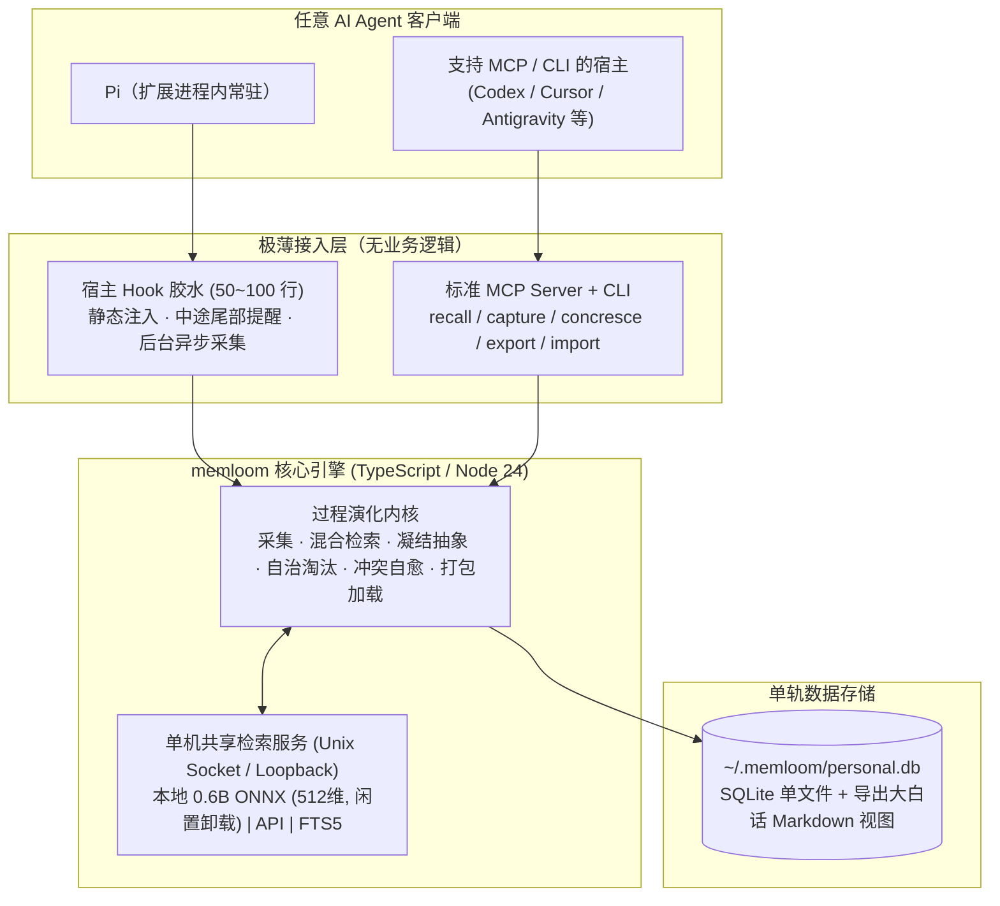

# memloom 使用说明

这份文档是根目录 [README](../README.md) 的展开版：安装细节、环境变量、三档检索模式、共享检索服务、命令行与归档格式、MCP、宿主核心与 Pi 的接法、和 agent-crew 的单向联动、各里程碑的最小闭环，以及本机的参考实测。

- 只想跑起来：看 README 的「快速开始」就够。
- 想知道数据长什么样、提示词怎么写、接口怎么定义：看 [ARCHITECTURE.md](ARCHITECTURE.md)。
- 想自己写宿主适配：看 [HOST-CONTRACT.md](HOST-CONTRACT.md)。

文中所有示例和测试都用临时目录，不碰真实的 `~/.memloom`。实测数字只说明「那一台机器那一次」，不是保证。

---

## 1. 安装与编译

```bash
# 需要 Node.js 24 或更新版本（直接用内建 node:sqlite，运行时零原生扩展）
# 按 package-lock.json 原样安装；环境里设了 NODE_ENV=production 时 npm 默认跳过 devDependencies，所以必须带 --include=dev
npm ci --include=dev --no-audit --no-fund
#   本机 npm 缓存里已有 typescript / @types/node 时可以加 --offline：npm ci --offline --include=dev --no-audit --no-fund
#   全新机器没有缓存时不要加 --offline，这一步需要联网装一次
npm run build   # tsc，产物在 dist/
npm test        # 先编译，再跑离线测试：只用临时文件库和合成样本，不联网、不调用任何外部模型或 API、不碰真实记忆
```

- 可选依赖 `onnxruntime-node` 和 `@huggingface/tokenizers` 会一起装；装不上也不影响 `fts-only` / `api` 模式的编译和运行。
- 编译后 `dist/src/cli/main.js` 就是 `memloom` 命令，`dist/src/mcp/main.js` 就是 MCP 服务（`package.json` 的 `bin` 已登记，`npm link` 后可直接用 `memloom` / `memloom-mcp`；不 link 就用 `node dist/src/cli/main.js`）。
- **路径要短**：共享检索服务靠 Unix socket 通信，`<状态目录>/retriever.sock` 不能超过 100 字节（Linux 内核上限 108 字节）。状态目录默认 `~/.memloom`；跑测试时临时目录取自 `TMPDIR`，它也要是短的公共路径（例如默认的 `/tmp`），不要指向很深的私有临时目录。太长时 memloom 会直接报「状态目录路径太长，Unix socket 放不下」，不会悄悄退化。
- 实测平台只有 Linux x86_64 + Node 24.15；Windows 没有测。

---

## 2. 目录与环境变量

| 位置 | 默认 | 怎么改 |
|---|---|---|
| home（库、导出、可读快照、会话快照都在这下面） | `~/.memloom` | `--home <目录>` / `MEMLOOM_HOME` |
| 个人库 | `<home>/personal.db` | `--db <库文件>` / `MEMLOOM_DB` |
| 项目库 | `<项目>/.team/.mind.db` | `--project <项目目录>`（读 `.team/manifest.json` 的 `project_id`）/ `MEMLOOM_PROJECT`，角色再加 `--role <名字>` / `MEMLOOM_ROLE` |
| 状态目录（共享检索服务的 socket、锁、日志，模型下载的状态和日志） | 同 home | `--state-dir <目录>` / `MEMLOOM_STATE_DIR` |
| 模型目录 | `<状态目录>/models` | `MEMLOOM_MODEL_DIR`；`memloom models` 命令另有 `--out <目录>` |
| 可读快照 | `<home>/readable/<作用域>/`（角色是 `readable/project-<编号>/role-<名字>/`） | 不单独配置 |

通用参数：`--home`、`--db`、`--project`、`--state-dir`、`--role`、`--scope`、`--json`。个人库只认 `personal`，项目库只认本项目和它的角色，别的组合直接拒绝。

环境变量：

| 变量 | 含义 |
|---|---|
| `MEMLOOM_RETRIEVER_MODE` | `local-onnx` / `api` / `fts-only`；不写就是 `auto`：有本地模型用本地，否则配了 API 用 API，否则 `fts-only` |
| `MEMLOOM_STATE_DIR`、`MEMLOOM_MODEL_DIR` | 显式 `local-onnx` 时两个都必须给；`auto` 模式不给就落到默认位置 |
| `MEMLOOM_RETRIEVER_IDLE_MS` | 共享检索服务完全闲置多少毫秒后退出（默认 10 分钟） |
| `MEMLOOM_API_BASE_URL`、`MEMLOOM_EMBED_MODEL`、`MEMLOOM_RERANK_MODEL`、`MEMLOOM_EMBED_DIMENSIONS`、`MEMLOOM_API_KEY` | API 模式；`api` 模式下前三个必填。凭据只在内存，不进 health、日志和报错 |
| `MEMLOOM_AUTO_DOWNLOAD` | `0` = 关闭自动下载：缺模型也永远只用字面检索，不联网 |
| `MEMLOOM_HF_ENDPOINT` / `HF_ENDPOINT` | 模型镜像源（命令行 `--mirror` 优先） |
| `MEMLOOM_ENV_FILE`、`MEMLOOM_NO_ENV_FILE` | 默认自动读取 `~/.config/memloom/env`（遵循 `$XDG_CONFIG_HOME/memloom/env`，只导入 `MEMLOOM_*` 和 `HF_ENDPOINT`，拒绝符号链接；进程里显式传入的变量永远优先）。`MEMLOOM_ENV_FILE` 可改路径，`MEMLOOM_NO_ENV_FILE=1` 关闭读取 |
| `MEMLOOM_LLM_BASE_URL`、`MEMLOOM_LLM_MODEL`、`MEMLOOM_LLM_API_KEY`、`MEMLOOM_LLM_REASONING_EFFORT`、`MEMLOOM_LLM_THINKING_FORMAT`、`MEMLOOM_LLM_TIMEOUT_MS` | 后台凝结模型：任意 OpenAI 兼容端点（含 `/v1`）。可选思考强度（如 `low` / `high` / `max`）与格式（`openai` 默认，或 `deepseek` 同时带 `thinking: { type: "enabled" }`），以及毫秒级超时（1000~600000） |
| `MEMLOOM_HINT_BUDGET_MS`、`MEMLOOM_HINT_THRESHOLD`、`MEMLOOM_WARMUP`、`MEMLOOM_CREW_CLI` | 宿主专用：提醒的前台预算（默认 2000）、提醒门槛（默认 0.72）、`0` = 不预热、可信的 agent-crew CLI 路径。详见 HOST-CONTRACT |
| `MEMLOOM_HOST_ENTRY` | Pi 适配专用：核心入口的 file URL，默认 `<仓库>/dist/src/host/index.js` |
| `MEMLOOM_TEST_MODEL_DIR`、`MEMLOOM_TEST_CREW_CLI` | 只给测试用：真实模型目录、真实 agent-crew `crew.mjs` 的绝对路径 |

---

## 3. 检索：三档模式、模型与共享服务

M2 在 M1 的字面召回之上加了语义层：**用可注入的 `Retriever` 做向量粗排 + M1 字面补位 → 去重精排 → 检索器不可用就退回 FTS**。代码在 `src/retriever/`，入口是 `dist/src/retriever/index.js`。三档模式：

| 模式 | 什么时候用 | 依赖 |
|---|---|---|
| `local-onnx`（默认推荐） | 本机 CPU 跑 Qwen3-Embedding-0.6B + Qwen3-Reranker-0.6B；同一个状态目录下所有会话只共享一份常驻模型 | 可选依赖 `onnxruntime-node` + `@huggingface/tokenizers`，以及下载好的公开模型目录 |
| `api` | 2~4 GB 的小主机；**只有你显式给出 base URL 才启用**，对齐 OpenAI 兼容的 `/v1/embeddings` 和 `/v1/rerank` | 无本地模型，凭据只在内存配置或环境变量里 |
| `fts-only` | 没模型、断网、服务起不来时的保底：SQLite FTS5 trigram + 参数化短词 | 零依赖 |

### 3.1 取模型：默认自动下，也可以手动下

默认（`auto` 没配 API，或显式 `local-onnx`）第一次召回发现本地没有模型时，**当场退回字面检索、不卡前台**，同时在后台拉起 `memloom models download`；两个模型都下完并校验通过后，同一个会话的下一次召回自动切到本地语义检索，不用重启。

```bash
memloom models status                                   # 目录、两个模型齐不齐、当前 modelId、后台下载进度或上次失败原因（只读，不联网）
memloom models download [--mirror <url>] [--out <目录>] [--embedding <文件名>] [--reranker <文件名>] [--background]
#   --background 写完状态就退出，下载放后台；--json 只输出最后的结果
node scripts/fetch-retriever-models.mjs --out ~/.memloom/models   # 旧脚本还在，只是上面这条命令的薄壳（需要先 npm run build）
```

- **下载量**：默认清单是 12 个文件、共 1,855,739,404 字节（约 1.86 GB）；总量硬上限 3 GiB，流写时也守着。
- **固定清单，不认镜像报的摘要**：仓库、revision（完整提交哈希）、允许的量化文件、每个文件的大小和 sha256 / git 摘要都编译在 `src/retriever/models-manifest.ts`（来自官方源元数据，并和已校验过的文件对过）。镜像只负责传字节；大小和摘要全对才 `rename` 成正式文件，一个模型的文件全部就绪才最后原子写它的 `memloom-model.json`。
- **镜像源**：优先级 `--mirror` > `MEMLOOM_HF_ENDPOINT` > `HF_ENDPOINT` > `https://huggingface.co`（例如 `https://hf-mirror.com`）。只接受 `https://`（地址只写到主机名和端口；离线测试允许 `http://127.0.0.1`）；每一跳跳转都重新检查，https 不许降到 http；请求不带凭据、不传用户文本，不执行远端代码，不碰系统代理。信任边界：字节来自镜像，**摘要来自代码里的固定清单**，所以镜像给坏文件只会被拒绝重下，不会污染模型。
- **关掉自动下载**：`MEMLOOM_AUTO_DOWNLOAD=0` 或代码里 `autoDownload: false`——缺模型时永远只做字面检索，不联网（`npm test` 就是这么统一关的）。已配置 API 或 `fts-only` 的模式从不下载本地模型。
- **续传 / 并发 / 退避**：写盘走 `<文件>.part` + HTTP Range（206 要对得上区间，服务端回 200 就从头重下），大小或摘要不对删掉重下一次（重下的字节同样计入 3 GiB 总量：累计收到多少就数多少，到上限就停、不再重试，网络缓冲里在途的几个字节只计数不落盘）；全程持有 `<模型目录>/.download.lock/`（文件版面包店算法：每个进程只有以自己 pid 命名的选择牌和票，内容写满才可见；票号最小的活着的那一个下载，其余退出不下载；只删自己的标记和确定已退出进程的唯一命名文件，活锁不抢），同一个模型目录同时只跑一个下载；状态写 `<状态目录>/model-download.json`（含进度、失败原因和 30 分钟退避时间），日志在 `<状态目录>/model-download.log`。失败后 30 分钟内不再自动拉起，之后下一次召回再试；手动 `memloom models download` 不受退避限制，但不能绕过活锁。
- 模型目录不进 Git。手动摆进去的合法模型也认（看文件不看目录），`memloom-model.json` 可有可无。
- **发布门槛**：目录不完整时开始下载，会先在根 `manifest.json` 原子写 `state: downloading`，两个模型的文件全部校验通过才各写 `memloom-model.json`，最后原子改成 `state: ready`——中间不管文件看起来多齐都不会被当成「已就绪」切过去（换一个状态目录看也一样），所以下完后的 modelId 一定带 revision。下载失败时目录保持 `downloading` 标记，下次成功下载后解除；手工摆好的完整目录不写这道门。
- 镜像源这条网络路径只在离线回环里验证过（本机 `127.0.0.1` 替身），没有对真实镜像站做过完整下载。

### 3.2 共享检索服务是怎么起的

- 客户端（`LocalRetriever`）**从不**在自己进程里加载 ONNX：第一次请求时用 `node daemon.js <状态目录>` 另起一个脱离父进程的服务，监听 `<状态目录>/retriever.sock`（目录 0700、socket 0600，只有当前用户能连）。
- 并发首启时几个客户端可能各拉起一个服务进程，它们在锁目录 `<状态目录>/retriever.lock/` 里各领一张票（文件名带自己的 pid，票号 = 当前最大票号 + 1，票号最小者独占——文件版的面包店互斥算法），决定谁加载模型；**只有独占成功且监听成功的那个进程才 import ONNX 运行时和模型**，其余的不加载就退出（测试里 5 个客户端并发首启，日志能看到 4 个输家）。别人只会在票的拥有者进程已经死了时清它的票（Linux 下连僵尸进程也算死），活着的服务不会被误删锁，也不会有人删它的 socket。
- 服务**完全闲置 10 分钟**（可配，测试里缩短）且没有在途请求就退出，socket 和锁一起清掉；下一次请求再按需拉起。崩溃后残留的 socket（连不上）会被新服务清掉，活着的服务和它的 socket 绝不动，也绝不杀任何进程。
- 给 M3 CLI 留的接口：`retriever.status()`（只探测不拉起）、`retriever.warmup()`、`retriever.stop()`（安全停止，在途请求做完就退）。服务协议只有 `embed / rerank / status / stop` 四个方法，没有执行外部命令的入口。

### 3.3 一条最小闭环（临时目录 + 真实本地模型）

```js
import { mkdtempSync } from 'node:fs';
import { tmpdir } from 'node:os';
import { join } from 'node:path';
import { openStore } from './dist/src/core/index.js';
import { LocalRetriever, hybridRecall, indexVectors, pickHints, formatHintBlock } from './dist/src/retriever/index.js';

const root = mkdtempSync(join(tmpdir(), 'memloom-m2-'));       // 只用临时目录
const store = openStore(join(root, 'demo.db'));
store.insertPrinciple({ scope: 'personal', now: new Date().toISOString(),
  triggerWhen: '当你准备递归删除一个目录的时候',
  rule: '先检查它是不是软链接，不要带尾斜杠直接 rm -rf，防止顺着链接误删目标目录' });

// 模型目录是上一步下载的；首次检索会自动拉起共享服务（冷启动加载模型要几秒）
const retriever = new LocalRetriever({ stateDir: join(root, 'state'), modelDir: process.env.MEMLOOM_MODEL_DIR });

console.log(await indexVectors({ store, retriever, scope: 'personal' }));   // 有界补建：每次最多 50 条，分批算
const result = await hybridRecall({ store, scope: 'personal', query: '递归删文件夹的时候把快捷方式指到的那份也删了', retriever });
console.log(result.mode);                                                     // { retriever: 'local-onnx', stage: 'full', reranked: true, ... }
for (const item of result.items.slice(0, 3)) console.log(item.score.toFixed(3), item.text);
console.log(formatHintBlock(pickHints(result.items)));                       // 只留精排分 ≥ 0.72 的前 2~3 条；没有就返回空字符串
await retriever.stop('示例收尾');
store.close();
```

`MEMLOOM_MODEL_DIR=~/.memloom/models node demo.mjs`。换一句查询就能看到三档的真实差别：`result.mode.stage` 会如实写 `full`（向量 + 字面 + 精排）、`lexical-rerank`、`lexical-only`（没经过模型精排，`pickHints` 返回空，不拿字面分冒充语义分）或 `vector-only`。

### 3.4 API 模式（显式配置）

```js
import { ApiRetriever } from './dist/src/retriever/index.js';
const retriever = new ApiRetriever({
  baseUrl: 'https://api.siliconflow.cn/v1',            // 必须显式给，含 /v1
  embedModel: 'Qwen/Qwen3-Embedding-0.6B', rerankModel: 'Qwen/Qwen3-Reranker-0.6B',
  apiKey: process.env.MEMLOOM_API_KEY,                  // 只放内存；不进 health、日志和报错
  dimensions: 512,                                      // 作为 dimensions 参数发给服务端并截断
});
```

也可以用 `createRetriever(retrieverConfigFromEnv())`，变量见第 2 节。API 模式只在离线回环（本机模拟的 OpenAI 兼容端点）上测过。

### 3.5 本机参考实测（Linux x86_64、Node 24.15.0、16 核、AVX2、8 线程；合成中文语料）

- 冷启动到模型就绪约 8~12 秒；之后单条向量化约 0.1 秒，精排一条文档约 0.27 秒，一次召回（12~15 条候选精排）约 3.3~4.5 秒。
- 双模型常驻 RSS 约 2.5~2.9 GiB（int8 向量模型 585 MiB + 动态 int8 精排模型 1163 MiB，加上 8 个线程的运行时开销）；测试里把闲置时间配成 20 秒，实测约 20.5 秒后进程退出、内存归零，下一次请求重新拉起——**默认配置是 10 分钟**，20 秒只是为了让测试跑得快。
- 同义句（字面一条都找不到）精排分：0.96 / 0.93 / 0.91；无关反例 ≤ 0.004；技术锚点 `ENOENT` 靠字面补位找回并精排 0.99。
- **这些只是这台机器这一次的实测，不是任何硬保证**；精排分对查询措辞敏感，短促的关键词式查询（如「编译之后才能测试」）可能只有 0.2~0.3，动态提醒会宁缺毋滥地保持安静。
- 2026-11-28 另一次真实下载：`memloom models download` 从官方源下完 12 个文件、1,855,739,404 字节，117 秒退出 0、没有残留的 `.part`；`doctor` 报告两个模型就绪，modelId `qwen3-embedding-0.6b@c25a394:int8:512`；`npm run test:real-model` 1/1（83.9 秒：5 个客户端共用一个服务、中文同义精排与反例、闲置退出和再启动）。那次 `TMPDIR` 很长时 Unix socket 先失败过一回，换成短的 `/tmp` 才通过——这就是第 1 节「路径要短」的来历。

---

## 4. 命令行与归档（M3）

M3 在内核和检索底座之上加了三个薄层：`src/portable/`（`.tar.gz` 导出 / 导入）、`src/app/`（命令行和 MCP 共用的一层业务胶水）、`src/cli/` 与 `src/mcp/`（两个入口，不重复业务）。

### 4.1 一条最小闭环（全程临时目录，不碰真实的 `~/.memloom`）

```bash
npm run build
export MEMLOOM_HOME=$(mktemp -d)            # 状态目录和默认库都落在这里；测试和示例都这么隔离
memloom --db $MEMLOOM_HOME/a.db capture --kind correction --summary "删目录之前先 ls -la 看一眼是不是软链接，确认后再删。"
memloom --db $MEMLOOM_HOME/a.db capture --message "不对，不要带尾斜杠直接 rm -rf。" --session s1 --turn 3   # 按原话检测纠错
memloom --db $MEMLOOM_HOME/a.db iron-rules add "没有明说怎么处理就不许擅自动手改用户的项目文件。"
memloom --db $MEMLOOM_HOME/a.db recall 软链接                       # 没模型时如实写 fts-only / lexical-only
memloom --db $MEMLOOM_HOME/a.db export --out $MEMLOOM_HOME/personal.tar.gz
memloom --db $MEMLOOM_HOME/b.db import $MEMLOOM_HOME/personal.tar.gz   # 新库导入；有模型时自动重建向量，没有就明说
memloom --db $MEMLOOM_HOME/b.db recall 软链接
memloom --db $MEMLOOM_HOME/b.db doctor                              # 配置、库完整性、容量、检索档位、本地模型与下载进度、服务状态；不启动模型
memloom daemon status | memloom daemon stop                         # 只探测 / 安全停止共享检索服务
```

命令与规格 §8 一一对应：`recall` / `capture` / `iron-rules list|add|disable` / `dilemmas list|resolve` / `concresce` / `export` / `import` / `daemon status|stop` / `models status|download` / `doctor` / `hook` / `craft sync`；`--json` 输出原始数据。退出码：0 正常，1 用法错或失败，2「没配置后台模型」这类什么都没做的情况。

- **分歧只能由人拍板**：`dilemmas resolve <编号> --choice A|B --confirm <编号>`，肯定标志必须等于分歧编号；A 保留现有原则、什么都不改；B 必须由用户逐字段给出 `--target <关联原则编号> --trigger … --rule … [--rationale …] [--core]`，按凝结核心同一套规则校验（长度、中文、去重、容量），新原则接替目标、旧条目标为已被替代留底；不接受一段自由文本，同一条分歧不执行第二次，不能跨作用域。
- **拍板落库之后**：A / B 都先在一个事务里落库（回执 `committed: true`），然后才做后置步骤——B 补建向量（没模型只是正常退化）、两者都刷新可读快照。后置步骤失败时命令行用非零退出，回执先写明「已落库，不是回滚」，**不用再拍一次板，也不用重新导入**：按回执里的报错处理（快照目录写不了就修目录权限，修好后之后的导入或分歧拍板会重新生成快照），想看整体状态运行 `memloom doctor`（检索档位、本地模型、缺向量的条数）。没建上向量的条目召回时只按字面找。
- **后台凝结**：`concresce` 需要 `MEMLOOM_LLM_BASE_URL`（任意 OpenAI 兼容端点，含 `/v1`）和 `MEMLOOM_LLM_MODEL`，凭据 `MEMLOOM_LLM_API_KEY` 只留在内存里的 Authorization 头；需要开启思考模式时可加 `MEMLOOM_LLM_REASONING_EFFORT`（如 `high` / `max`）和 `MEMLOOM_LLM_THINKING_FORMAT`（`openai` 或 `deepseek`）。这些配置推荐放进 `~/.config/memloom/env`（权限设为 `600`），命令行、MCP 和宿主扩展会自动读取且不覆盖显式传入的环境变量。没配置时直接说明并退出 2，不会调用任何默认服务；配置了就意味着凝结时会把待处理经历、现有原则和铁律发给这个端点（`doctor` 会写明）。模型回复整段当不可信数据，仍由 `src/core/condense.ts` 整体校验后才落库。

### 4.2 归档格式（规格 §7）与安全边界

`memloom-<scope>-<日期>.tar.gz` 只装纯文本：`manifest.json`（`schema_version` / `scope` / `exported_at` / `counts` / 每个成员的 SHA-256 / 掩蔽与排除清单）、`iron_rules.json`（含启用状态）、`principles.json`（全部原则，含状态、血缘、统计、时间）、`experiences.jsonl`（精选经历：被原则引用的全部 + 待处理的全部 + 最近 30 条 + 高命中 20 条，封顶 500）、`readable/STANDING.md` 与 `readable/PRINCIPLES.md`；项目域另带 `team/`（`.team` 下的 `.md/.json/.txt/.yaml/.yml/.csv`）。没有 SQLite、向量字节、缓存和模型；自己写的包 `tar -tzf` 能原样列出。tar 读写是自己实现的最小 ustar 版本（`src/portable/tar.ts`，`node:zlib` 做 gzip，零依赖）：只认普通文件和目录项，符号链接、硬链接、设备、管道、PAX / GNU 扩展头、base-256 一律拒绝；gzip 解压带输出上限；成员路径不许绝对路径、`..`、反斜杠、控制字符。

导入的顺序是「先全部校验，再一个事务写库」：gzip 上限 → tar 成员 → 成员集合（只允许上面这些 + `team/`）→ manifest 版本 → 每个成员 SHA-256 → 数量 → 记录字段（多一个字段都算坏包）→ 包内重复；任何一步不对整包拒收、一个字节不写。

- **凭据**：`.team` 里像凭据的文件名（`.env*`、`*.pem`、`*.key`、`*.db`、`*.lock`、`*.onnx`、`id_rsa*`、`.npmrc`、`.netrc` 等）和 `.git/`、`node_modules/`、`models/` 不打包；记录字段（铁律、原则、经历、team 文本）里能明确判断的常见凭据（`sk-…`、`ghp_…`、`AKIA…`、`xox?-*`、JWT、`Bearer …`、`hf_…`、`npm_…`、网址里的账号密码、`api_key=` 这类键值、PEM 私钥块）换成 `[已掩蔽:类型]` 并登记在 `manifest.masked`，导入时再兜一次底。**memloom 不能保证识别所有秘密**（不认识的令牌、口令、内网地址会原样保留），导出后请人手目检。
- **读端只拒重复编号和无效结构，不拒「两个合法编号、内容相同」的记录**（产品自己导出的包必须能读回）。导入时的「同一条」按稳定身份认：经历 = 类别 + 总结 + 引文 + 来源会话 + 发生时间（同总结但引文 / 类别 / 会话不同的经历是不同证据，各自保留）；铁律 = 正文 + 启停状态：恢复到空库时同文的停用版和生效版各还原一条、同文同状态去重；合并到已有库时本地已有同文的绝不改、也不另插一条同文生效的去绕过本地明确停用，优先对应同状态那条，否则跳过并把差异写进 `iron_rules.state_conflicts`）；原则 = 正文 + 状态（历史版本再带创建时间，同文的生效版和历史版不折叠、血缘不自指；本地已淘汰 / 替代的同文原则不被归档里的生效版复活，列进 `conflicts`）。
- **跨库编号**：包里用 `iron:N` / `p:N` / `exp:N` 记源库编号，导入时按本次内容翻译成本地编号；包里没带上的引用显式省略并计数，说明文字里的「原则 #N」也一起翻译，绝不留下指向别人同号记录的裸编号。
- **merge（默认）**：按内容指纹（和凝结核心同一套归一化）去重，重复导入零新增；文字一样只补血缘，不改本地文本、强度和状态；字面接近但内容不同、或状态不同的，不导入并列在回执 `conflicts` 里（本地文本和归档文本都给出），由人决定；可注入的语义判断（`judge`，`src/portable/import.ts`）认出同义时合并到本地那条，返回不可信编号就整包不导。铁律只补缺，从不改本地已有（文本和启用状态都不动）。
- **replace（显式 `--mode replace`）**：在 merge 之上，把目标作用域里「包里没有的生效原则」软退役留底（写明原因）；别的作用域、铁律、手写文件照旧不动。
- **`.team` 文件**：只属于 `project:<id>` 归档，角色 / 个人归档绝不带也不写；项目 / 角色归档的 manifest 带 `project_id`，导入只认同一个项目（另一个项目的同名角色直接拒绝）。数据库提交后写入 `<项目>/.team/`，从 `.team` 到目标逐级拒绝符号链接和非普通文件（不写、不比较、不顺着走），只写目标里不存在的；每个文件的新写 / 一致 / 冲突 / 没能写（原因）分别回报。`--project` 入口遇到 `.team`、`manifest.json` 或库文件是符号链接也直接拒绝。
- **事务与后置步骤分开报**：写库在一个 `BEGIN IMMEDIATE` 事务里，容量硬上限在事务内复核，中途失败整体回滚。纯配置问题（例如只给了 `MEMLOOM_API_BASE_URL` 没给模型名）在落库前就拒绝，此时什么都没写。事务提交后回执带 `committed: true`，三个后置步骤（`.team` 文本、向量重建、可读快照）各自报告成功 / 正常退化（没配向量模型）/ 失败（原因 + 重试），`post_failures` 计数；失败时命令行先用非零退出并写明「数据库已提交，不是回滚」，MCP 标 `isError` 但回执结构照给。**导入**的重试办法是重新导入同一个包（重复导入不产生重复记录，只补做没完成的后置步骤）。分歧拍板见 4.1：已落库就不用再拍，也不是重新导入的事。可读快照写到 `<home>/readable/<作用域>/`（角色带项目编号：`readable/project-<id>/role-<名字>/`），不写进项目目录。

---

## 5. MCP（stdio）

任意支持 MCP 的客户端这样配：命令 `node`，参数 `dist/src/mcp/main.js`（或 `memloom-mcp`），环境变量同命令行（`MEMLOOM_HOME` / `MEMLOOM_DB` / `MEMLOOM_PROJECT` / `MEMLOOM_ROLE` / 检索配置 / 后台模型配置）。工具与命令行一一对应、共用同一层：`memloom_recall`、`memloom_capture`、`memloom_iron_rules`、`memloom_dilemmas`、`memloom_concresce`、`memloom_export`、`memloom_import`，外加兼容入口 `memloom_resolve_dilemma`（等同 `memloom_dilemmas` 的 resolve，同样要求 `choice` + `confirm=分歧编号`）。stdout 只走 MCP 协议，诊断只写 stderr；工具参数里的 `scope` 只能用当前库该管的作用域。

---

## 6. 宿主核心与 Pi（M4）

M4 把「注入 + 采集 + 调度 + 跨仓联动」写成一层**宿主无关核心** `src/host/`（入口 `dist/src/host/index.js`）：Pi 的扩展在进程内常驻调用它；别的宿主可以用通用子进程入口 `node dist/src/host/hook-cli.js --event`（`memloom hook --event`；stdin 一条事件 JSON，stdout 一条回执 JSON，永远退出 0）。适配层只做「取事件 → 调核心 → 把三段文字放到该放的位置」，不写 SQL、检索、提示词、凝结。契约（事件 / 回执字段、三段文字的放置位置、目录边界、和 agent-crew 的单向联动）见 [HOST-CONTRACT.md](HOST-CONTRACT.md)，Pi 的事件映射和实测证据见 [adapters/README.md](../adapters/README.md)。

### 6.1 接 Pi

```bash
npm run build
pi -e /path/to/memloom/adapters/pi/index.ts     # 只多加一个 -e；不装全局、不写 ~/.pi/agent 的任何配置
node adapters/smoke-pi.mjs --core both          # 想先看它做了什么：真实 pi + 回环模拟模型端点，全在临时目录，约 10 秒
```

### 6.2 一条最小闭环（临时目录 + 注入的离线模型，不联网、不碰真实 `~/.memloom`）

```js
import { HostCore, resolveHostConfig } from './dist/src/host/index.js';

process.env.MEMLOOM_HOME = '/tmp/memloom-m4-demo';           // 状态目录和个人库都落在这里
const config = resolveHostConfig({}, process.env);           // 个人作用域；项目 / 角色会话给 { project: '<目录>', role: '<角色>' }
const core = new HostCore(config);                           // 检索器可注入（第二个参数 { retriever }）；不给就按第 2、3 节的环境变量造
const start = await core.handle({ type: 'session_start', sessionId: 'pi-会话号' });
// start.staticBlock：整场固定字节的常驻底座（铁律 + ≤8 条核心 + 一句工具说明，≤3,000 字）；start.dilemmaNotice：分歧短通知（同批一次）
for (const prompt of prompts) {
  const turn = await core.handle({ type: 'user_message', sessionId: 'pi-会话号', text: prompt });
  // turn.hint：当轮尾部提醒（精排分 ≥ 0.72 的 0~3 条，≤400 字；寒暄 / 斜杠 / 无高分就是 ''）
  // turn.correction：用户强纠错时已立刻入库；turn.background：登记的后台活动（不等它）
  await core.handle({ type: 'tool_result', sessionId: 'pi-会话号', toolName: 'bash', isError: false, exitCode: 0, output: '…' });
}
await core.handle({ type: 'session_end', sessionId: 'pi-会话号' });   // 关会话前抢救最近未覆盖的 ≤20 条
core.close();
```

- **静态区**只在 `session_start` 算一次，存进会话临时状态；同一会话（含 Pi 续会话、重载、压缩后的再次 `session_start`）原字节返回，新会话才重算。
- **动态提醒**：一次提醒（一条用户消息，或一个失败的工具批次）在前台最多等 `MEMLOOM_HINT_BUDGET_MS`（默认 2000 毫秒），候选缩到几条，超时就丢、不补发；没模型 / 冷启动 / 坏模型一律静默，不用字面分冒充语义分。这 2 秒是**单次预算**，不是实时承诺：不承诺供应商的缓存命中率，也不是几十毫秒级的检索。会话开始默认在后台预热共享检索服务（`MEMLOOM_WARMUP=0` 关），宿主进程从不加载 ONNX。本机（16 核、Node 24.15）这一次的温态实测：6 条候选整次召回 1.40~1.63 秒，冷启动 8~13 秒，所以默认预算是 2000 毫秒而不是更低；嫌慢可以调低预算（提醒会更少）。同一批工具里只想让某一个失败出提醒时，适配层给 `tool_result` 标 `skipHint: true`，核心照常计数和调度、只是不再等检索。
- **后台活动**（纠错即时凝结、每 10 轮 / 15 次工具调用复盘抽取、压缩 / 关会话前抢救）只在配置了后台模型时才做，同一会话串行、最多 1 跑 1 等；送给后台的对话先去掉 memloom 自己的注入文字。会话内的任务在进程内跑，关会话 / 压缩前的抢救由脱离的短命子进程做（宿主退出也做得完），没有常驻调度服务。
- **模型自动下载**：`auto` / `local-onnx` 模式下本地模型没下齐时，`session_start` 会登记一次 `model-download` 后台活动（`spawned` / `coalesced` / `skipped`），下完之前提醒照常静默，下完之后的下一次提醒自动走本地语义检索。
- **会话快照**在 `<home>/sessions/<会话>.json`（0600，目录 0700），文件名按「库路径 + 作用域 + 会话号」散列，同名的另一个库 / 作用域各存各的：只有静态区文本、计数器、去重键和最近消息片段，没有凭据。关会话（`session_end`）仍当场安排最近窗口的抢救，然后**清掉对话片段**，但保留同一库同一作用域的静态字节 / 去重 / 限频游标——Pi 用 `-c` 续会话、reload 换了进程，同 sessionId 拿回的原字节不变，新会话才读到新铁律；7 天未更新整个清掉。它不是第二份记忆真源——记忆只有 SQLite 四张表。
- **短命抢救的传参**：关会话 / 压缩前的抢救由脱离的短命子进程（`node hook-cli.js --job`）做，Pi 进程退出也做得完。任务说明只在 `<home>/jobs/` 短暂落盘、子进程读完即删（拉起失败或子进程没读就退出时父进程兜底清掉），里面只有端点、模型名、作用域、路径和要抽取的那段对话；**后台模型的凭据只通过子进程环境变量传，说明文件里永远没有**。
- **分歧轻声通知**：还没提醒过的 open 分歧 ≥ 3 条或其中有撞铁律的，才在下一新会话开场附两行提示（记一次 `surfaced_count`，同批只一次）；拍板仍走 M3 的 `dilemmas resolve`，核心不替用户决定。

---

## 7. 和 agent-crew 的单向联动（可选）

- 项目 / 角色会话必须显式给 `MEMLOOM_PROJECT`（含 `.team/manifest.json` 的目录；角色再加 `MEMLOOM_ROLE`，且角色必须已存在），库固定在 `.team/.mind.db`，个人库照旧独立；没有任何把项目内容升格进 personal 的路径。
- 凝结成功后核心把当前作用域的生效原则投到 `.team/CRAFT.md`（项目）或 `.team/roles/<角色>/CRAFT.md`（角色）的 `<!-- memloom:craft:start/end -->` 管理区：`- ★ <触发场景>：<行动准则>`，常驻核心优先；区外字节原样、手写条目保留，整份不超过 40 条（放不下就少写并报告，不截句）。目标或父级是链接、标记不成对，一个字节不写。也可以手动触发：`memloom --project <目录> [--role <角色>] craft sync`。
- `BRIEF.md` 只由 agent-crew 自己的 `crew brief --write` 渲染：`memloom craft sync --brief` 只有在 `MEMLOOM_CREW_CLI` 指向可信的 `crew.mjs`（绝对路径、普通文件）时才用参数数组调它（无 shell、30 秒超时），没有配置就如实提示手动命令。
- `tests/host-interop.test.ts` 里和真实 agent-crew 的那条用例，先看环境变量 `MEMLOOM_TEST_CREW_CLI`（`crew.mjs` 的绝对路径），没给就按编译产物的位置找和 memloom 同级的克隆（`../agent-crew/scripts/crew.mjs`），都没有就跳过并提示怎么给；它不看 cwd、不写任何本机路径；它只在临时项目里建队、加角色、写 CRAFT、刷新速览、`crew check` 和打包，不改 agent-crew 仓。

---

## 8. 内核最小闭环（M1）

M1 只交付核心内核：单文件 SQLite 真源、经历采集、字面召回、凝结与三级冲突自愈。**模型一律通过可注入接口进来**（`CondenseModel` / `ExtractionModel` / `DuplicateJudge`），仓库不自带任何外部模型；召回只有 FTS5 trigram + 参数化 LIKE 的字面检索，没有语义向量，也不冒充语义检索。

```js
import { openStore, captureCorrection, searchExperiences, condense } from './dist/src/core/index.js';

const store = openStore(':memory:');   // 演示用内存库，关掉就没了；要落盘就显式给一个临时文件路径，同库用 scope 隔离
const captured = captureCorrection(store, {
  scope: 'personal', sessionId: 's1', turn: 1,
  message: '不对，删目录之前先 ls -la 看一眼是不是软链接。',
});
if ('skipped' in captured) throw new Error('没有检测到纠错，示例走不下去');

// 召回：只用汉字，靠「软链接」三字窗口就能找回这条经历
console.log(searchExperiences(store, { scope: 'personal', query: '删目录之前要先看看是不是软链接' })
  .map((hit) => hit.experience.summary));

// 凝结：模型是注入的，这里是离线模拟（换成你自己的模型适配即可），把这条纠错提成一条带触发场景和行动准则的中文原则
const model = {
  id: 'offline-mock',
  plan: async (ctx) => ctx.experiences.map((e) => ({
    action: 'add',
    trigger_when: '当你准备删除一个目录的时候',
    rule: '先 ls -la 看一眼它是不是软链接，确认后再删，不要带尾斜杠。',
    rationale: '用户刚刚纠正了直接删的做法',
    is_core: false,
    source_experience_ids: [e.id],
  })),
};
const result = await condense({
  store, scope: 'personal', model,
  reason: captured.condense.reason,             // 纠错即时入口：一条经历就跑，不用攒满 15 条
  experienceIds: captured.condense.experienceIds,
});
console.log(result.actions);                    // [ { action: 'add', principleId: 1 } ]
for (const p of store.listPrinciples('personal')) console.log(`${p.triggerWhen}：${p.rule}`);
store.close();
```

运行后打印三行：找回的经历总结、`[ { action: 'add', principleId: 1 } ]`、以及那条新原则的「触发场景：行动准则」。

代码在 `src/core/`（`schema` 表结构、`store` 真源、`recall` 字面召回、`capture` 采集、`condense` 凝结）和 `src/prompts/m1.ts`（中文提示词）；测试在 `tests/`。

---

## 9. 测试

```bash
npm test                      # 离线全套（含编译）：临时库 + 可注入替身 + 离线替身守护进程的多进程测试 + 回环 API 模拟 + 回环模型下载；
                              # 不联网、不碰真实记忆。tests/fixtures/offline-preload.mjs 统一把 MEMLOOM_AUTO_DOWNLOAD 关掉并清掉镜像源变量
MEMLOOM_TEST_MODEL_DIR=~/.memloom/models npm run test:real-model   # 人工主动：真实模型 5 客户端并发 / 中文正反例 / 闲置退出（约 80 秒）
node --test dist/tests/adapter-pi.test.js                       # Pi 适配的离线映射回归（先 npm run build）
```

离线用例覆盖的范围：tar / gzip 往返与不可信输入边界、导出 / 导入往返与冲突、真实进程命令行端到端、回环 OpenAI 兼容端点凝结、官方 SDK 客户端走 stdio 调 MCP、宿主核心与跨仓联动、模型下载的校验 / 断点续传 / 并发锁 / 失败退避 / 热切换。用例数以运行输出为准。

---

## 10. 项目结构与路线图

### 10.1 整体形态与跨 Agent 接法



- **核心层与 MCP / CLI**：完全脱离特定宿主，任何支持 MCP 或命令行的 Agent 都能连上同一个个人大脑。
- **宿主 Hook 胶水（`adapters/`）**：每个宿主只写 50~100 行极薄胶水，负责「无感自动注入」和「后台静默采集」，全部核心逻辑都在内核里只写一遍。
- **与 `agent-crew` 协作**：当具体项目启用 [agent-crew](https://github.com/Jarcis-cy/agent-crew) 时，`memloom` 可以按项目作用域为该项目的专家团队提供同样的语义检索与经验凝结加速，同时保持项目目录里的 `.team/*.md` 为跨 Agent 便携真源。

### 10.2 目录结构与路线图

- **运行时**：TypeScript + Node.js 24+（直接使用 Node 24 内置 `node:sqlite`，免除本地 C++ 扩展编译烦恼）
- **本地检索**：`onnxruntime-node` / `@huggingface/tokenizers`（默认跑 `Qwen3-Embedding-0.6B` + `Qwen3-Reranker-0.6B` 量化版）
- **对外协议**：Model Context Protocol (`@modelcontextprotocol/sdk`) + 标准 CLI

```text
memloom/
├── docs/
│   ├── USAGE.md               # 本文档：安装、环境变量、检索、命令行、宿主接法、参考实测
│   ├── HOST-CONTRACT.md       # 宿主契约：事件 / 回执字段、三段文字放哪、和 agent-crew 的单向联动
│   └── ARCHITECTURE.md        # 完整架构规格书（表结构、检索、注入、提示词、迁移与验收标准）
├── src/
│   ├── core/                  # 单轨数据库、经历采集、凝结抽象、淘汰与冲突自愈
│   ├── retriever/             # 单机共享检索服务 + 本地 ONNX / API / FTS5 三档适配 + 模型下载
│   ├── prompts/               # 纯中文大白话提示词与反压缩约束
│   ├── portable/              # 一句话导出/导入打包与向量重建
│   ├── app/                   # 命令行和 MCP 共用的业务胶水
│   ├── host/                  # 宿主无关核心（注入、采集、调度、agent-crew 联动）与通用子进程入口
│   ├── mcp/                   # 标准 MCP Server
│   └── cli/                   # 命令行入口 (memloom)
├── adapters/
│   ├── pi/                    # 极薄 Pi Extension 胶水
│   └── (其它宿主走 src/host/ 的通用事件入口，不承诺具体适配)
├── scripts/fetch-retriever-models.mjs   # 旧的一次性取证脚本，现在是 memloom models download 的薄壳
├── tests/                     # 离线单测与中文检索/纠错/自治回归测试
└── AGENTS.md                  # 给施工 Agent 的项目纪律与验收清单
```

路线图：

- **M1：核心存储与基础演化内核** — 单文件 SQLite 四表模型、铁律保护、大白话采集/凝结/淘汰与三级冲突自愈、离线测试全绿。
- **M2：单机共享轻量检索底座** — 跑通本地 0.6B ONNX（INT8/Q4，512 维）+ 闲置卸载、OpenAI 兼容 API 切换、中文 FTS5 兜底及混合精排。
- **M3：便携打包、MCP 与 CLI** — 完成 `export / import` 无损迁移与秒级向量重建，暴露完整 MCP Server 与 CLI。
- **M4：极薄宿主胶水与实测验收** — 落地宿主无关核心 `src/host/`（静态区 / 动态提醒 / 纠错即时入库 / 后台复盘与抢救 / 分歧通知 / agent-crew 联动）和 Pi 胶水。

---

## 11. 已知边界与没有验证过的

- 提醒的 2 秒是单次前台预算，不是延迟承诺；供应商的前缀缓存命中与计费不由 memloom 决定，也没有实测过。
- 归档掩蔽只认常见凭据格式，不保证识别所有秘密。
- 镜像源只在离线回环里验证；真实镜像站的完整下载没有做过。
- API 模式只在离线回环端点上测过；Pi 只在 1.4.0 上实跑（1.6.0 只核对了类型声明）；TUI 里的 `/new`、`/resume`、`/reload`、steer / followUp 没有真实触发过。
- Windows 没有测。
- 拍板或导入之后缺向量的条目没有单独的补建命令：有模型时它们会在下一次导入或分歧拍板时补建，在那之前召回只按字面找；`memloom doctor` 能看到缺多少。
